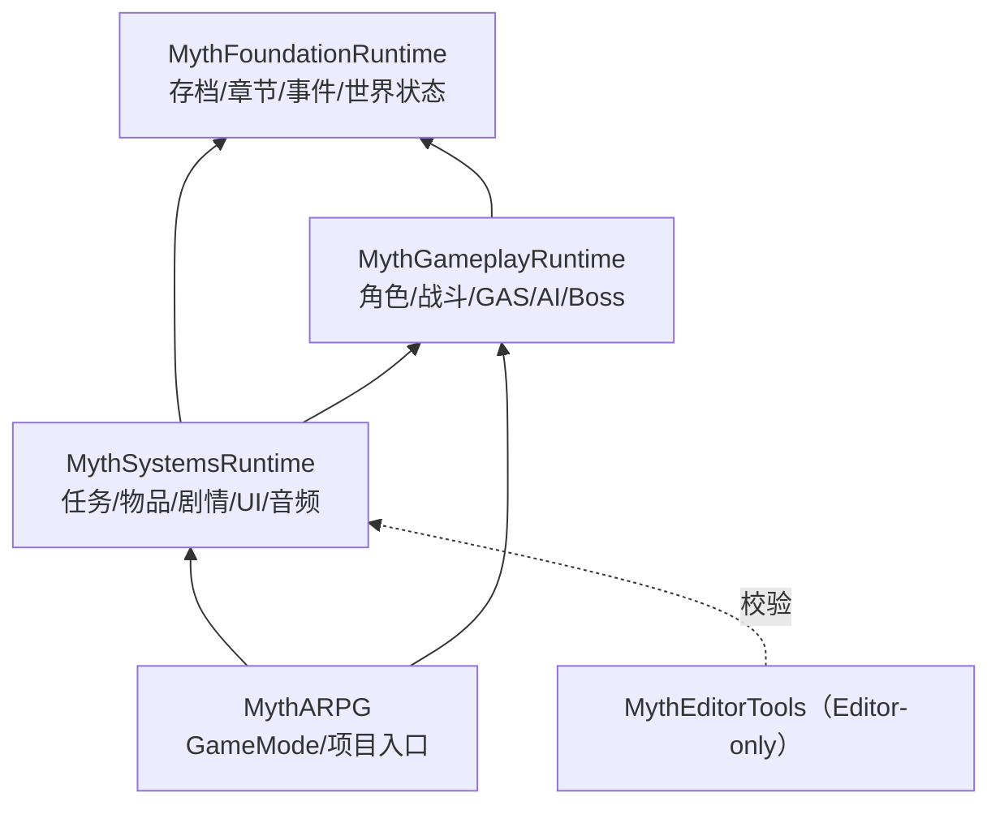

# 00｜总体架构与模块依赖（当前架构总览）

> 本文以 v1.0 候选源码为基线。历史阶段中的“待开发”描述不代表现在仍没有对应类。所有模块**尚未经 Unreal 编译与运行验证**。

## 目标与边界

游戏类型：纯单机、第三人称、动作 RPG、章节式长篇剧情；规划七章，第一章作为首个内容交付。现在仓库只包含跨章节共用的源码、模块和配置示例，没有可玩地图、正式模型/动画、NPC 或章节任务内容。

要求：共用系统不直接写死某章 Actor；章节通过稳定 ID 和数据资产注册；进度可跨地图保存；蓝图负责资源装配和表现，C++ 负责稳定规则。

## 设计原理：职责与依赖

这不是“所有模块互相调用”的许可。命令应走公开接口，跨域通知走稳定事件，显示层仅订阅状态。避免 Blueprint 到处 Cast 到关卡 Actor。

### 谁管理什么状态

| 生命周期 | 应放在何处 | 例子 |
|---|---|---|
| 角色存活期 | Actor / ActorComponent / GAS | 当前攻击、精力、格挡、AI 目标 |
| 当前遭遇战 | `AMythEncounterDirector` | 当前波次、敌人列表 |
| 一次本地玩家会话 | `ULocalPlayerSubsystem` | 输入重绑定 |
| 跨地图及一次游戏进度 | `UGameInstanceSubsystem` + Save Snapshot | 背包、任务、章节、世界标志 |
| 资源定义期 | `UPrimaryDataAsset` / Data Asset | 攻击、物品、任务、章节表 |
| 编辑器运行期 | `MythEditorTools` | ID 重复和引用完整性检查 |

**反例**：把开宝箱状态保存在宝箱 Actor 的普通 bool 上，地图卸载后 bool 消失。正确做法是使用稳定 PersistentId 将已开启状态写入世界进度，再在 Actor 重新生成后恢复。

## 系统工作流

**攻击**：输入 → ActionComponent 仲裁 → GAS Ability → Montage/Notify → WeaponTrace Sweep → GameplayEffect → AttributeSet → 受击/死亡/事件。

**剧情**：任务状态、条件和世界标志 → NarrativeCommand 组成一次事务 → SaveSubsystem 更新快照 → 持久信号队列投递 → Quest / UI 等消费并按收据去重。

**跨地图**：ChapterCatalog 提供 ChapterId 与入口地图软引用 → ChapterTravelSubsystem 校验并保存 → OpenLevel → 加载回调恢复。断电、失败或损坏存档需要引擎内压力测试。

## 数据定义与保存数据的区别

- `UMythItemDefinition`：所有同类物品共享的定义，不存玩家手里有多少。
- 物品数量、唯一装备 GUID、升级进度：属于 `FMythCampaignSnapshot`。
- `UMythQuestDefinition`：任务阶段与条件的定义。
- 当前任务在哪个 Stage、哪些奖励已经领过：属于存档。
- `UMythChapterDefinition`：章节入口和元信息。
- 当前 ChapterId/CheckpointId 与永久世界变化：属于存档。

## 新功能设计检查表

新增系统之前先回答：其状态存活多久？对外提供命令还是通知？哪个系统是唯一真相？需不需要稳定 ID、存档迁移与事件去重？Actor 卸载与游戏中断是否安全？是否存在 Debug 接口和自动化测试？

## 商业级门禁

现阶段只有**候选源码**与静态脚本；要达到正式使用，还必须完成 UBT/UHT 编译、UE 编辑器加载、PIE 与 Shipping 行为验证、保存故障注入、动画同步测试和性能预算测量。详见 [08 集成验收](08_INTEGRATION_QA.md) 和 [17 最新候选说明](17_FOUNDATION_V10.md)。
