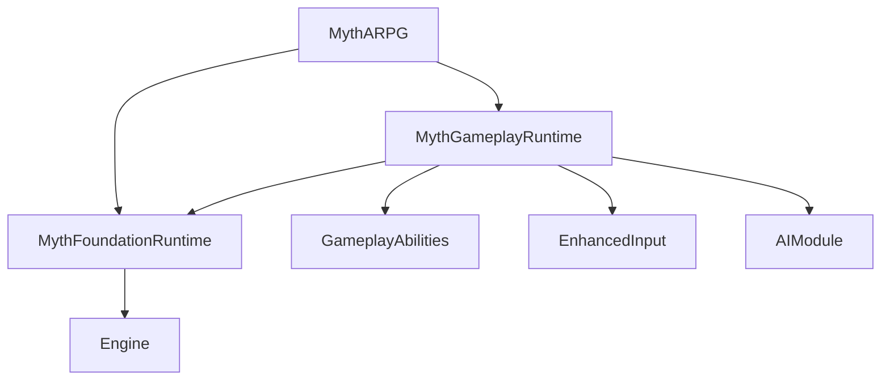

# 00 — Commercial ARPG architecture contract

## Success target

A 7-chapter, single-player third-person action RPG, targeting 30–45 hours when all chapters are produced. The **first deliverable is Chapter 01**; only this chapter is content-scoped. Core runtime needs long-lived, stable contracts. This starter is **Phase 01** of development, not Chapter 01 content-complete.

## Module DAG



The planned extension DAG, to be added as systems become real:

```
MythFoundationRuntime
   | DataRegistry / chapter asset IDs / typed events / versioned persistence
   +---- MythGameplayRuntime: combatants, GAS, targeting, AI interfaces
   +---- MythProgressionRuntime: items, equipment, skills, economy
   +---- MythWorldRuntime: interactables, checkpoint, world registry
   +---- MythNarrativeRuntime: quests, dialogue, cinematic orchestration
   +---- MythPresentationRuntime: UI state, cameras, audio, accessibility
MythARPG (composition root): GameMode, actual rulesets, chapter content wiring
MythEditor (Editor-only): validators, authoring tooling, content commandlets
```

These extension module names are **proposed**, not already created. Only split them when a domain contains enough concrete code and a stable API. Splitting prematurely makes builds harder.

## Runtime ownership and lifetime

| Subsystem / object | Engine owner | Live scope | Rule |
|---|---|---|---|
| Save | `UGameInstanceSubsystem` | across world travel | Snapshot data, never store Actor pointers |
| Events | `UGameInstanceSubsystem` | across world travel | Scoped subscriptions and unsubscribe during teardown |
| Chapter registry | future GI subsystem | across world travel | Stable ChapterId -> soft asset reference |
| World state registry | future `UWorldSubsystem` | per streamed world | Actor stable ID, capture/apply persistent state |
| Quest runtime | future GI subsystem | save slot session | Rule processing, no Blueprint hard links to level actor |
| Character state | Actor + GAS | per life/actor | Damage, status, abilities; not GI state |
| AI | AIController + StateTree | current encounter | Decisions only; fire ability requests |
| UI widgets | Local player/UI layers | per local UI context | Observe model; cannot change save values directly |

## Communication rules

1. C++ interfaces for commands with a result (Interact, TrySpend, ApplyItem).
2. Owned delegates for same-domain changes (HealthChanged, OnDeath).
3. Typed domain events for cross-domain facts (BossDefeated, QuestCompleted).
4. Avoid Blueprint casting between chapter-specific actors; use stable IDs.
5. No dynamic hard reference to a future chapter from Chapter01.
6. Battle actions are activated via GAS. Gameplay Effects own stat mutations.

## Ownership: single-player

No net driver/server logic is needed. GAS is used because it models actions/effects/tags, not because this is multiplayer. Don't introduce network abstractions before there's a product requirement.

## Planned systems inventory (implementation state)

Legend: `C` = in starter C++, `P` = partial prototype, `D` = documented design only.

| Domain | Systems | State |
|---|---|---|
| Core | GameMode, basic module config, events | C |
| Core | chapter data asset, primary asset IDs | P |
| Core | asset manager discovery, async streaming, time services, object pooling | D |
| Combat | GAS ASC, attributes, damage GE, basic melee, dodge, faction | P |
| Combat | combo graph, cancel rules, hit window sweep, parry, poise, execute, feedback, lock-on | D |
| Character | camera rig, move/look Enhanced Input, basic movement | P |
| Animation | anim layers, montages, IK, root motion, motion warping, synchronized executions | D |
| AI | periodic distance chase and attack | P |
| AI | perception, EQS, StateTree, squad director, encounter rules | D |
| Boss | 3 fixed HP phases, persistent defeat | P |
| Boss | transition guards, arena mechanics, enrage, cinematic skip, reset policy | D |
| World | player spawn, map authoring instructions | P |
| World | checkpoints, streaming, interactables, doors, puzzles, loot spawners, persistent registry | D |
| RPG | damage/stat definition | P |
| RPG | inventory, equip, item instances, skill DAG, currency, transactions, loot, shops, crafting | D |
| Narrative | boss-defeated fact event | C |
| Narrative | quest graph, flags, branching, dialogue, sequence director, cutscene skip | D |
| Save | sync SaveGame slot, player snapshot and defeated bosses | P |
| Save | schema migration, checksums, backup, async atomic commit, checkpoints, multi-slot | D |
| UX | third-person camera | P |
| UX | HUD, settings, menu, map, subtitles, accessibility, localization, audio | D |
| Ops | one math unit test | P |
| Ops | CI, tests for all behaviors, content validation, profiling budgets, packaged QA | D |

## Content boundaries

`/Game/Core` for shared BP content; `/Game/Chapters/Chapter01` for all one-off Chapter 01 content. Content follows IDs like `CH01_Q_Main_01`, `CH01_Boss_01`, `CH01_CP_03`. Treat IDs as serialized contracts; maintain renaming migration tables.
