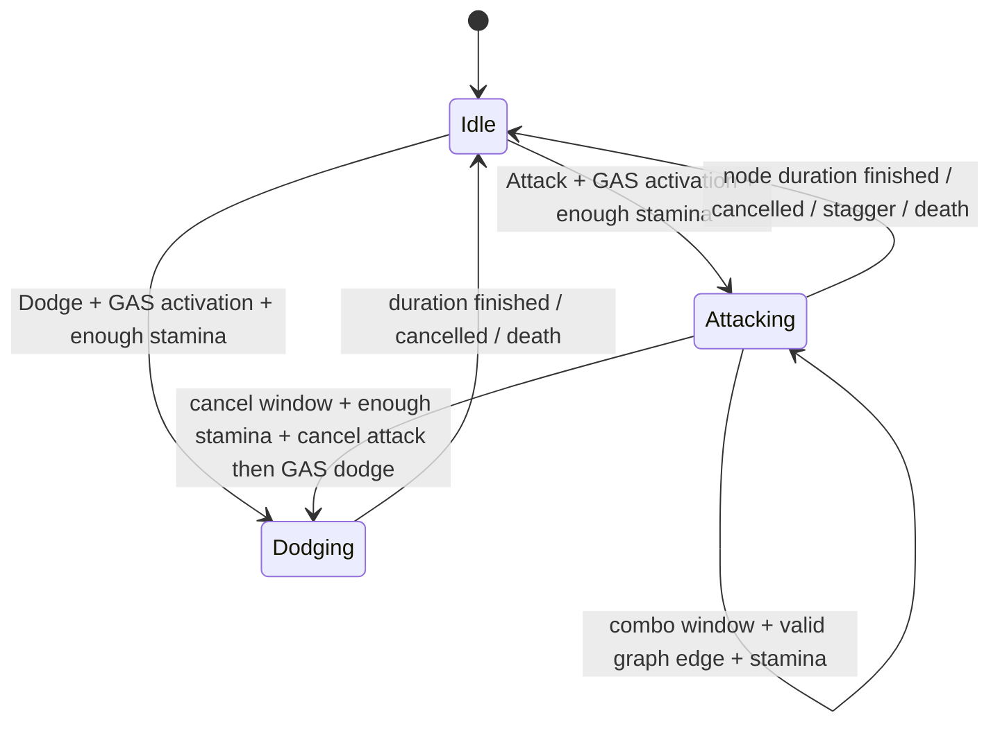

# v0.2 商业级动作战斗框架：技术约定

状态：**源码实现，未经过 Unreal Engine/UHT/UBT 编译或运行测试**。这是玩法垂直切片，不是已验收的商业级战斗系统。

## 1. 模块依赖 / 唯一真相

- `AMythCombatCharacter`：身份、阵营、伤害结算入口、死亡、资源恢复以及 GAS `AttributeSet`。
- `UMythActionComponent`：**唯一动作仲裁者**；Attack/Dodge 两种互斥动作、输入缓冲、连招推进、消耗精力、取消规则、Montage 播放、超时保护、动作标签。
- `UMythMeleeAbility` / `UMythDodgeAbility`：GAS 激活 / 取消与生命周期的唯一入口；绝不直接碰撞、扣血或自己维护另一套动作计时器。
- `UMythComboGraph`：主数据资产，负责节点、分支及校验；不存在动画时使用代码中的三轻一重回退。
- `UMythWeaponTraceComponent`：只在命中窗口 Tick，记录上一帧 Socket 坐标，用 Sweep 扫掠、每个窗口对目标去重；**不持有伤害公式**。
- `UMythAttributeSet`：Health、Stamina、Poise、Defense；Health 与 Poise 都由 `UMythDamageEffect` 改动；精力消耗与恢复现阶段为 ASC BaseValue 修改，后续可统一到 GameplayEffect 执行策略。
- `UMythLockOnComponent`：只在锁定时 Tick，目标搜索、可见性检查、切换和镜头朝向。

## 2. 动作状态图

`State.Combat.Staggered` 和 `State.Character.Dead` 是独立的资格状态，能阻止新动作；韧性打断调用 GAS CancelAllAbilities，然后回到 Idle。窗口关闭或死亡后务必清空攻击迹线和活跃标签。

## 3. 默认调试连招（没有任何动画也能执行）

- `Light1`：0.70 秒，伤害倍率 1.0；命中 0.14~0.33，连招输入 0.30~0.58，闪避取消 0.35~0.65。
- `Light2`：0.70 秒，伤害倍率 1.15；可转 `Light3` 或 `Heavy1`。
- `Light3`：0.70 秒，伤害倍率 1.5；结束当前连招。
- `Heavy1`：1.00 秒，伤害倍率 2.0、韧性伤害 65；单独重击或二段轻击后的派生重击。
- 输入缓存有效期默认 0.38 秒；重击和轻击使用 `EMythAttackInput` 区分。
- 起始节点均在执行时消耗精力；连招切换到后续节点也会重新消耗该节点精力，精力不足则不发生切换。

**重要：** 回退模式仅用于验证战斗代码，真正的攻击可读性取决于 Animation Montage / Root Motion / 武器 Socket；不能把回退球形采样认作商业级命中精度。

## 4. 编辑器自定义的连招图

创建 `DA_Combo_Player`（基类 `MythComboGraph`），按下列索引安排 `Nodes`：

| NodeId | 入口 | Montage | 建议用途 |
|---|---|---|---|
| Light1 | Light | AM_Light1 | 第一段 |
| Light2 | Light | AM_Light2 | 第二段 |
| Light3 | Light | AM_Light3 | 第三段 |
| Heavy1 | Heavy | AM_Heavy1 | 重击和派生 |

把 `EntryLight` 配为 `Light1`、`EntryHeavy` 配为 `Heavy1`。`Links` 建议：

1. `Light1 + Light → Light2`
2. `Light2 + Light → Light3`
3. `Light2 + Heavy → Heavy1`

在玩家 BP 的 ActionComponent 上选择 `ComboGraph=DA_Combo_Player`。

## 5. 时间轴契约

每个节点有 `HitOpen/HitClose`、`ComboOpen/ComboClose`、`DodgeCancelOpen/DodgeCancelClose`、`Duration`。如果 `bUseAnimationNotifies=false`，这些窗口由 Timer 实现；可在纯代码测试场景运行。

如果 `bUseAnimationNotifies=true` 且 Montage 成功播放：

- `Myth Hit Window` 控制武器轨迹检测。
- `Myth Combo Window` 控制接受下一段输入。
- `Myth Dodge Cancel Window` 控制打断后摇以闪避。
- `Duration` 仍是**兜底结束时间**，请与对应 Montage 持续时间一致，避免动画已经结束但能力还未结束。
- 对闪避，可在组件中指定 DodgeMontage，勾选 `bDodgeUseAnimationNotifies`，由 `Myth Dodge IFrames` 通知窗口控制无敌帧；否则用 DodgeIFrameOpen/Close Timer。

应避免在同一段 Montage 上重复叠加相同类型窗口。Montage 切换时后续需要加入完整的 animation instance token/notify source 验证，防止旧动画延迟通知影响新动作。

## 6. 命中契约

1. `BeginTrace` 开启后，立即采集一帧（确保静止对象仍可命中），后续每帧 Sweep。
2. 使用 `weapon_base`、`weapon_mid`、`weapon_tip` 三个 Socket；没有 Socket 时退化为角色前方三个虚拟点以利调试。
3. 同一目标每个攻击窗口最多触发一次，下一招刷新缓存。
4. 检查阵营、死亡、无敌帧后，通过 `AMythCombatCharacter::ApplyMeleeHit` 生成含 Health 和 Poise 修正的 GameplayEffect。
5. `HitResult` 记录在 GameplayEffect Context，为未来受击方向、伤口反馈、处决命中部位作准备。

后续需要升级：物理材质/盔甲部位、精细敌人受击骨骼、武器高速穿透测试、动画异步通知去重、不同技能窗口的多击配置、受击方向、招架与防御。

## 7. GAS 生命周期不变量

- 活跃动作只有一个：Idle / Attacking / Dodging。
- 一次攻击序列期间 GAS Melee Ability 保持激活；内部转换连招节点无需反复发起 Ability。
- `EndAbility` 通过 ActionComponent 执行清理；取消应清理所有定时器、迹线、Montage 和由动作授予的 Loose Tags。
- Dodge 请求先检查可否取消和精力是否足够，**不会**在无法消耗精力时取消已执行的招式。
- Poise 归零触发硬直标签，取消活跃能力，在计时结束后恢复 Poise。
- Boss 阶段和死亡事件沿用 v0.1；这轮没有完成 Boss 专用技能配置和 StateTree。

## 8. 下一次应投入的开发

一旦在 UE5.8 编译和 PIE 通过，优先实现：可预测的实际动画长度驱动、角色 Motion Warping / Root Motion、动画变更回调与 Action Token、加速/减速命中采样测试、移动/攻击转向、受击动画、格挡/招架、GAS Cost Effect 统一、战斗可视化调试，然后才扩展战斗 AI。
