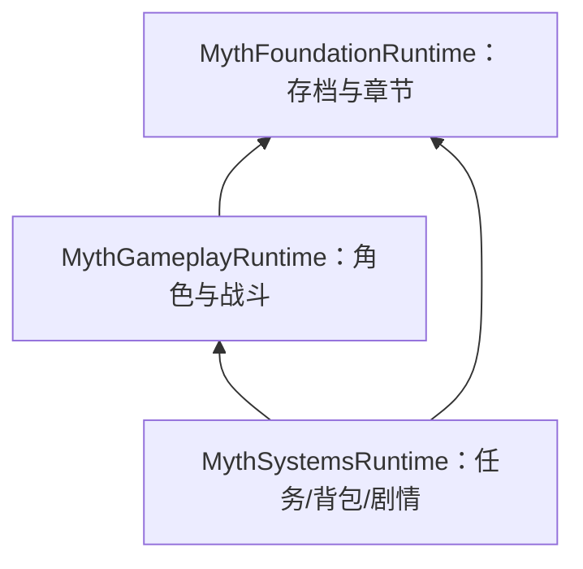

# 09｜v0.3 通用运行时：章节、背包、任务和世界状态

> 历史版本记录，描述 v0.3 引入的功能。最新系统边界以 [README](../README.md) 和 [17](17_FOUNDATION_V10.md) 为准。本工程未经过 Unreal 引擎编译或运行验证。

## 为什么要新增这些模块？

v0.2 主要解决“玩家怎样打敌人”。但一款长篇 ARPG 还必须回答“打完以后获得什么、任务怎样推进、切图以后记住什么”。因此新增 **MythSystemsRuntime**，并由 **MythFoundationRuntime** 保管跨地图进度快照。



## 核心类与职责

| 类 | 管什么 | 如何使用 |
| --- | --- | --- |
| `FMythCampaignSnapshot` | 角色、物品、任务、章节和世界标志 | 由 SaveSubsystem 管理，不由 UI 直接改 |
| `UMythChapterSubsystem` | 注册和解锁章节 | 在 ChapterCatalog 中登记稳定 ChapterId |
| `UMythInventorySubsystem` | 物品、货币、装备和制作 | `AddItem`、`Equip`、`Craft` |
| `UMythQuestSubsystem` | 任务和目标计数 | `StartQuest`、`ReportGameplayEvent` |
| `UMythNarrativeSubsystem` | 运行对话节点 | `StartDialogue`、`Choose`、`StopDialogue` |
| `UMythCheckpointSubsystem` | 记录检查点 | 调用 `ActivateCheckpoint` |
| `UMythWorldStateSubsystem` | 世界永久标志和计数 | 通过稳定 ID 恢复场景变化 |

## 资源目录怎么注册

在 Unreal 创建 ChapterCatalog、ItemCatalog、QuestCatalog、ProgressionRules、SkillTreeDefinition 的数据资产。可以通过 Bootstrap 的配置引用：

```ini
[/Script/MythSystemsRuntime.MythBootstrapSubsystem]
ChapterCatalogPath=/Game/Core/Data/DA_Chapters.DA_Chapters
ItemCatalogPath=/Game/Core/Data/DA_Items.DA_Items
QuestCatalogPath=/Game/Core/Data/DA_Quests.DA_Quests
ProgressionRulesPath=/Game/Core/Data/DA_Progression.DA_Progression
SkillTreePath=/Game/Core/Data/DA_Skills.DA_Skills
```

以上路径仅为示例，仓库不包含这些 UAsset。也可在启动时调用 `UMythBootstrapSubsystem::InitializeCatalogs`。未注册内容目录的情况下，相应功能可能不可用。

## 历史限制及后续变化

v0.3 的异步存档尚不具备完整磁盘回退；v0.4 引入 A/B 两代存档。任务原先主要是有序阶段计数，v0.5 增加条件分支，v1.0 增加持久事件队列。AI 最初只做规则决策，v0.8 增加 StateTree/EQS 接口。

**这些是源码演进，不等于实际引擎集成已完成。** 完整使用流程请看 [README](../README.md)。
