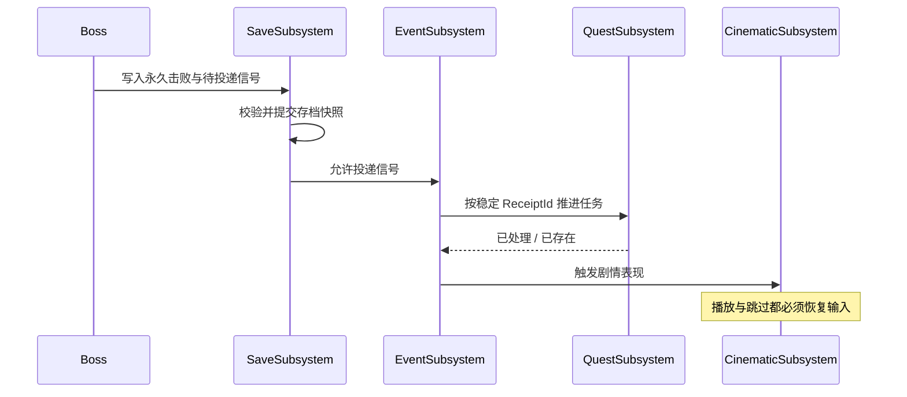

# 17｜v1.0 候选底层：动画同步、原生 AI 任务、输入与可靠剧情

> **当前状态：已提交源码，但未经 UnrealBuildTool、UnrealHeaderTool、PIE、Shipping 编译与验收。** 这份文档是最新功能边界说明，不是“项目已商业级完工”的证明。

## 一、这一版到底解决什么

v0.2～v0.9 逐步建立角色、战斗、AI、RPG、任务、存档与章节，但仍存在跨系统衔接风险：动画中断残留状态、处决动作无法双角色同步、StateTree 缺少可复用原生任务、键位与声音需要真正服务入口、剧情事件提交后掉电可能丢失。v1.0 候选版为这些问题补上了相应的 C++ 机制。

## 二、主要类与使用入口

| 源码类/功能 | 负责什么 | 使用时必须提供什么 |
| --- | --- | --- |
| `UMythExecutionComponent` | 两角色 Montage 启动、Motion Warping、处决命中、双方清理 | 匹配的骨骼/蒙太奇、Warp Target 和动画通知 |
| `UMythActionComponent` | Montage 生命周期，攻击、闪避和取消清理 | 正确的连招图、Notify 和时间边界 |
| `FMythCombatDecisionTask` | 在 StateTree 中请求已有 AI 战斗决策 | Controller 参数绑定与攻击上下文 |
| `FMythTacticalMoveTask` | 在 StateTree 中发起和使用战术位置查询 | EQS Query、NavMesh、状态退出清理 |
| `UMythInputBindingSubsystem` | 本地玩家按键映射和设置持久化 | Player Mappable 的 IMC 与稳定映射名称 |
| `UMythAudioDirectorSubsystem` | 基于 SoundMix/SoundClass 的音量路由 | Master/Music/Effects/Dialogue 的音频资产 |
| `UMythCinematicSubsystem` | Sequencer 播放、跳过与输入状态恢复 | Level Sequence、演出结束监听 |
| 持久 Outbox | 在存档里记录待投递业务信号 | 稳定事件 ID、业务消费收据、重试策略 |
| 章节恢复标记 | 记录跨地图转换的上一个安全状态 | ChapterCatalog、CheckpointId 和合法入口地图 |

## 三、最关键的数据约定：剧情结果不能依赖动画结束

假设 Boss 死亡后要发奖励、解锁通道、播放过场：

Outbox 使**至少一次投递**成为可能，但不保证所有业务天然“恰好一次”。如果任务、成就、奖励系统收到相同事件两次，每个消费者仍需要依据 ReceiptId 去重。对话、奖励和世界标志要写在正确的业务提交路径，不能只依赖某个 Blueprint 的视觉事件。

## 四、需要在 UE 中实际创建什么

### 动画/处决

创建玩家和敌人的 Animation Montage；校对骨骼、Root Motion、Motion Warping 窗口及 Warp Target 名称。配置冲击点 Notify、攻击与受击同步。必须测试双方死亡、控制切换、被打断、动画提前结束和地图卸载时的清理。

### StateTree / EQS

创建 StateTree Asset（合适的 AI Controller Schema），把原生任务绑定到正确的 Controller；配置 EQS Query 的导航、视线和距离评分。单纯添加 Task C++ 文件不会自动获得敌人行为。

### 输入、声音、界面

在 IMC 给按键加入 Player Mappable 名称，并由设置界面调用 `UMythInputBindingSubsystem::Rebind` 与 `SaveBindings`。创建 SoundMix、SoundClass，并在相关音频 Director 配置；UMG 菜单需要订阅 UI 路由并正确处理输入焦点。

### 过场

创建 Level Sequence，交给 `UMythCinematicSubsystem` 播放；结束/跳过以后由任务或叙事指令完成真正的状态提交。**Sequencer 不直接代表任务完成。**

## 五、完整集成测试清单

1. 编译 UE5.8 Development Editor、Game 和 Shipping，并检查 UHT 反射宏与模块依赖。
2. 在最小竞技场使用可兼容的临时动画测试处决成功、双方死亡、中断、跳过、重进和超时。
3. StateTree/EQS 测试无目标、目标死亡、NavMesh 不可达、UnPossess 和异步回调取消。
4. 输入映射测试键盘/手柄、重名映射、多个 Slot、重启保存、恢复默认。
5. 音频和 UI 测试暂停、切图、过场结束/跳过、旧世界焦点回收。
6. 模拟“剧情快照已提交但信号尚未派发就退出”，重启后任务不重复计数、奖励不重复发放。
7. 存档测试 A/B 两代都损坏、旧版本迁移、切图未完成恢复和平台文件权限错误。
8. Shipping 版本完整灰盒流程、目标硬件帧率、内存、加载卡顿与长时稳定性。

## 六、当前限制和技术风险

- 存在部分早期同步加载和模块集成接口，需要编译及性能审计。
- 本仓库没有正式 Montage/StateTree/EQS/UMG/Level Sequence/SoundMix/地图等资源资产。
- 过场播放接口不自动提交任务结果，调用方必须在业务层正确执行状态变化。
- Python 静态检查和测试**源码**不等于真实 UE Automation 的通过记录。
- “通用底层源码表面已覆盖”不等于“可发行商业级底层已完成”。

面向开发者的全面入口见 [README](../README.md)；验收与剩余工作见 [10](10_SYSTEM_BACKLOG.md) 和 [08](08_INTEGRATION_QA.md)。
