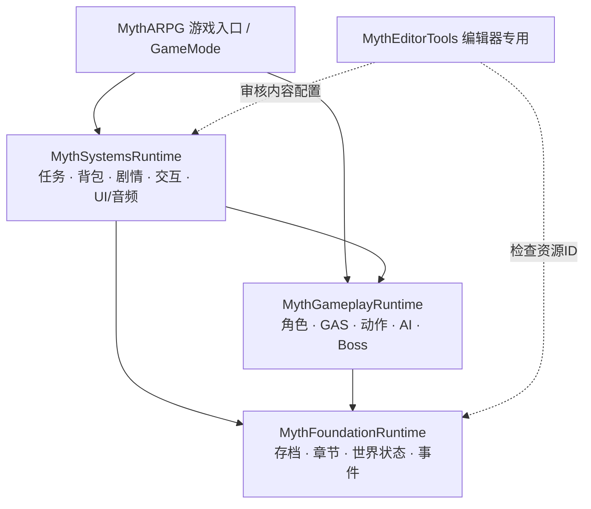
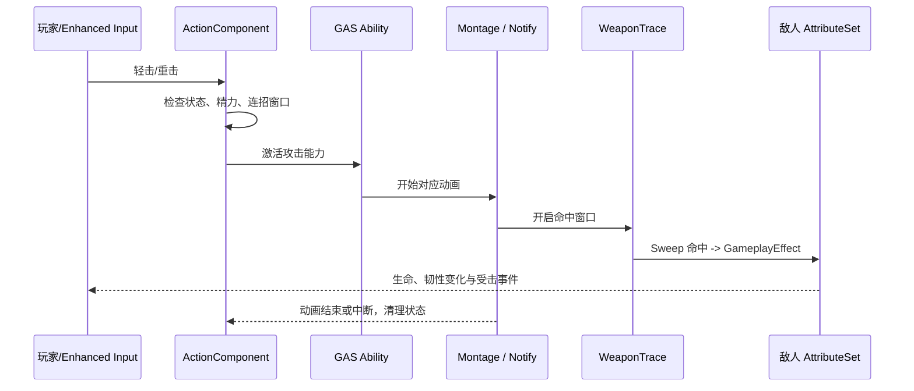

# MythARPG｜UE5 单机动作 RPG 通用框架

> **项目状态：v1.0 候选源码（未编译、未完成引擎集成）**。这是可供各章节复用的 C++ 框架，不是已经能够直接游玩的游戏。仓库暂时没有第一章地图、角色模型、Animation Blueprint、Montage、StateTree、EQS、UMG Widget 等内容资产；也没有完成 UnrealBuildTool（UBT）、UnrealHeaderTool（UHT）、PIE 或 Shipping 验收。

这是一个使用 **Unreal Engine 5.8 + C++ + Blueprint + Data Asset** 构建的第三人称、剧情驱动、纯单机动作 RPG 项目。计划先实现第一章，再逐步拓展其他章节；底层架构按多章节长流程、多个 Boss、装备成长与任务叙事的需求设计。

## 目录导航

- [一、项目到底怎么设计](#一项目到底怎么设计)
- [二、工程有哪些模块](#二工程有哪些模块)
- [三、运行时对象的职责](#三运行时对象的职责)
- [四、三个完整的数据流程](#四三个完整的数据流程)
- [五、怎样在 Unreal 编辑器里使用](#五怎样在-unreal-编辑器里使用)
- [六、怎样新增敌人Boss任务和章节](#六怎样新增敌人boss任务和章节)
- [七、C++ 与蓝图数据资产怎么分工](#七-c-与蓝图数据资产怎么分工)
- [八、存档与长剧情的可靠性](#八存档与长剧情的可靠性)
- [九、测试构建和开发约定](#九测试构建和开发约定)
- [十、已实现与尚未完成的界线](#十已实现与尚未完成的界线)
- [专题文档](#专题文档)

## 一、项目到底怎么设计

本项目采用**规则与内容分离**的设计。比如“攻击会耗精力、产生伤害、造成韧性变化”属于程序规则；某个 Boss 用什么模型、几段攻击动画、伤害数值、台词和地图，属于具体内容。它们不该硬编码在一起。

最重要的四条原则：

1. **统一规则**：玩家、敌人、Boss 共用尽可能一致的 GAS 属性、伤害和动作执行机制。
2. **数据驱动**：连招图、敌人配置、物品、技能树、任务、对话、章节等用 Data Asset 或稳定 ID 描述。
3. **按生命周期放状态**：跨地图的存档与任务保存在 GameInstance Subsystem；角色战斗状态留在 Actor/Component；临时关卡 Actor 必须能安全销毁和重建。
4. **事件只传事实，存档才是真相**：Boss 击败后先持久化相关进度和待投递事件，再通知任务、UI 等订阅者。收到重复事件不得重复发奖。



箭头表示主要编译期依赖关系；具体以各模块 `Build.cs` 为准。**编辑器模块不应进入 Shipping 运行时**。

### 为什么没有把全部玩法塞进 PlayerCharacter？

如果把攻击、背包、任务、剧情、存档都放在 `AMythPlayerCharacter`，每次角色重生或切地图都必须处理大量交叉引用，且换主角、NPC 或新章节会极难维护。现在玩家 Character 主要负责组合组件和接收输入；存档、任务、物品等有自己的运行时服务。

## 二、工程有哪些模块

```text
MythARPG/
├── MythARPG.uproject
├── Config/                         # Engine / Input / GameplayTags
├── Source/MythARPG/                 # 游戏模块入口、GameMode
├── Plugins/
│   ├── MythFoundation/Source/MythFoundationRuntime/
│   │   ├── Public/                  # Save、Chapter、WorldState、Event 接口/数据
│   │   └── Private/                 # 具体实现与 Tests
│   ├── MythGameplay/Source/MythGameplayRuntime/
│   │   ├── Public/                  # Character、GAS、Action、AI、Boss 接口
│   │   └── Private/                 # 具体实现、Notify 与 Tests
│   ├── MythSystems/Source/MythSystemsRuntime/
│   │   ├── Public/                  # Inventory、Quest、Dialogue、UI 等接口
│   │   └── Private/
│   └── MythEditor/Source/MythEditorTools/ # 仅编辑器运行
├── Scripts/                        # 静态结构检查
└── Docs/                           # 中文架构与开发手册
```

| 模块 | 核心类举例 | 主要职责 |
| --- | --- | --- |
| `MythFoundationRuntime` | `UMythSaveSubsystem`, `UMythChapterSubsystem`, `UMythChapterTravelSubsystem`, `UMythWorldStateSubsystem`, `UMythEventSubsystem` | 跨地图持久数据、切章、事件、恢复 |
| `MythGameplayRuntime` | `AMythCombatCharacter`, `UMythActionComponent`, `UMythWeaponTraceComponent`, `UMythDefenseComponent`, `AMythEnemyAIController`, `UMythExecutionComponent` | 战斗、控制、动画同步、AI 与 Boss |
| `MythSystemsRuntime` | `UMythInventorySubsystem`, `UMythQuestSubsystem`, `UMythNarrativeSubsystem`, `UMythEncounterDirector`, `UMythUIRouterSubsystem` | 物品、成长、任务、交互、遭遇战、表现服务 |
| `MythEditorTools` | `UMythContentAuditLibrary` | 配置与持久化 ID 检查 |
| `MythARPG` | `AMythGameMode` | 把默认角色和游戏规则装配到一起 |

注意：`MythSystemsRuntime` 当前把多个领域放在一个模块，是为了避免过早拆出十多个插件；等接口稳定、真正需要独立编译时再按领域拆分。

## 三、运行时对象的职责

**Actor / Component**（随角色或世界销毁）：`AMythPlayerCharacter` 接收 Enhanced Input；`UMythActionComponent` 仲裁动作与连招；`UMythWeaponTraceComponent` 管理命中窗口；`UMythDefenseComponent` 处理格挡/招架；`UMythExecutionComponent` 处理双人处决同步；`AMythEncounterDirector` 管理某个战斗区域的波次。

**GameInstance Subsystem**（跨关卡存活）：存档、章节注册/切换、背包、任务、剧情、世界进度、UI 路由、音频和设置等运行服务。服务不应长期持有已经卸载地图的 Actor 裸指针。

**LocalPlayer Subsystem**：`UMythInputBindingSubsystem` 管理当前本地玩家的可重绑定键位。手柄和键盘需要在 IMC 中提供 Player Mappable 配置。

**数据资产**：`UMythComboGraph`、`UMythCombatantDefinition`、`UMythBossPhaseDefinition`、`UMythItemCatalog`、`UMythQuestCatalog`、`UMythChapterCatalog`、`UMythEncounterDefinition` 等，是“可以在编辑器里填的规则参数/内容配置”，**不是运行时存档**。

## 四、三个完整的数据流程

### 例一：玩家挥出一刀



**为什么这样分？** `ActionComponent` 决定能不能出招，`Montage` 指定什么时候打到人，`WeaponTrace` 决定打中了谁，GAS 负责属性效果。以后更换武器动画或增加连招时，不需要重新实现生命系统。

### 例二：击败 Boss 推进主线

```text
Boss 死亡
  → Boss 战斗代码判断唯一击杀
  → SaveSubsystem 写入永久击败状态和待投递信号
  → EventSubsystem 投递事件
  → QuestSubsystem 按 QuestId/StageId/稳定收据推进任务
  → Narrative/WorldState 根据条件改变世界
  → UI 通过订阅刷新
```

事件队列采用**至少一次投递**理念：掉电/崩溃可能使事件再次出现，因此业务消费者必须按稳定收据去重。不能把“播放完过场”当成任务状态的唯一依据。

### 例三：跨章节进入下一个地图

`UMythChapterTravelSubsystem::RequestChapterTravel(ChapterId, CheckpointId)` 按状态执行：

`Idle → Resolving → Saving → OpeningMap → Arrived / Failed`。

切图前记录恢复信息；如果加载失败或启动发现未完成的切图记录，尝试回到原检查点。章节地图用软引用定义，不在第一章代码中硬编码第二章地址。**跨地图恢复仍必须在真实 PIE/打包场景进行故障注入测试。**

## 五、怎样在 Unreal 编辑器里使用

> 本仓库没有预先制作好的蓝图和地图，以下是**需要你在编辑器中完成的资源配置步骤**，不是已经能直接打开游玩。

1. 克隆仓库：`git clone https://github.com/yuqingbingxian/MythARPG.git`。使用 UE5.8 和匹配的 Windows C++ 工具链打开 `MythARPG.uproject`。先解决真实 UBT/UHT 编译问题。
2. 在 `Content/Core/Input` 中建立 `IA_Move`、`IA_Look`、`IA_Attack`、`IA_Heavy`、`IA_Dodge`、`IA_Guard`、`IA_Parry`、`IA_LockOn`、`IA_Save` 和 `IMC_Player`。
3. 创建 `BP_Player` 继承 `AMythPlayerCharacter`，在 Class Defaults 中填写输入 Action 和 Mapping Context；创建 `BP_GameMode` 继承 `AMythGameMode` 并将默认 Pawn 指向 `BP_Player`。
4. 创建测试地图，放入地面、`PlayerStart`、`NavMeshBoundsVolume`。创建 `BP_Enemy` 继承 `AMythEnemyCharacter`，再配置对应 `UMythCombatantDefinition` 数据资产。
5. 如果没有正式动画，可先用内置轻重击计时窗口做程序测试。接入动画后创建 `UMythComboGraph` 资产，给节点分配 Montage，在 Montage 的 Notify Track 配置 Hit/Combo/Cancel/IFrame 窗口，并在武器/骨骼上设置 `weapon_base`、`weapon_mid`、`weapon_tip` Socket。
6. 创建全局目录数据资产：`UMythChapterCatalog`、`UMythItemCatalog`、`UMythQuestCatalog`、`UMythProgressionRules`、`UMythSkillTreeDefinition`；可在 GameInstance 运行时用 `UMythBootstrapSubsystem::InitializeCatalogs` 注册，或按下方 INI 配置软引用。
7. 创建任务/物品/对话/遭遇战数据，再用交互组件、关卡 Actor 或触发器调用公开 API。不要把奖励计数直接写在 Level Blueprint 中。
8. 为所有涉及的 Actor、AI、动画、UI、Sequencer、SoundMix 等设置具体资产引用。运行 Automation、PIE 和打包测试才能确定系统真正工作。

```ini
[/Script/MythSystemsRuntime.MythBootstrapSubsystem]
ChapterCatalogPath=/Game/Core/Data/DA_Chapters.DA_Chapters
ItemCatalogPath=/Game/Core/Data/DA_Items.DA_Items
QuestCatalogPath=/Game/Core/Data/DA_Quests.DA_Quests
ProgressionRulesPath=/Game/Core/Data/DA_Progression.DA_Progression
SkillTreePath=/Game/Core/Data/DA_Skills.DA_Skills
```

这些路径是**示例**，仓库目前没有对应的 `.uasset`。若你使用不同的路径，需要修改配置或在游戏启动阶段调用 `InitializeCatalogs`。参考 [编辑器搭建手册](Docs/07_EDITOR_SETUP_V02.md)。

## 六、怎样新增敌人Boss任务和章节

| 需求 | 主要操作 | 底层一般无需改动 |
| --- | --- | --- |
| 新敌人 | 新建继承 `AMythEnemyCharacter` 的 BP，设置 Mesh/AnimBP、CombatantDefinition、AI Profile 和技能 | 生命/伤害/GAS/感知/死亡 |
| 新 Boss | 基于 `AMythBossCharacter` 建 BP，分配唯一 BossId、PhaseDefinition、Montage、战场控制和奖励 | 通用阶段、持久标志、任务信号 |
| 新战斗遭遇 | 建 `UMythEncounterDefinition`，填写波次、敌人软类、出生点；在地图放 `AMythEncounterDirector` | 异步预加载、波次计数与重置 |
| 新道具/武器 | 定义 ItemId、数值、堆叠上限，登记 ItemCatalog；装备实例带 GUID | 背包、装备、存档和交易 |
| 新任务 | 定义 QuestId、阶段/目标、前置条件和奖励，注册 QuestCatalog | 通用事件计数、阶段流转与幂等收据 |
| 新对话 | 定义 Dialogue 节点、选项、条件和命令；由 NPC 触发 `StartDialogue` | 选项判断、故事标志、剧情指令 |
| 新章节 | 在 ChapterCatalog 中注册新 ChapterId、软地图、解锁条件与检查点，制作章节内容 | 章节请求、存档、跨图恢复 |

**新增内容不等于零代码。** 如果新增飞行、复杂抓取、独特的世界规则，仍需要扩展通用系统；但普通敌人、任务和章节不应各复制一套框架。

## 七、C++ 与蓝图数据资产怎么分工

- **C++**：规则与不变量（伤害、库存交易、存档、动作取消、任务推进、唯一收据、资源生命周期）。
- **Blueprint**：把已有规则组合成实际对象；表现、触发器、事件回调、NPC/怪物子类及关卡拼接。
- **Data Asset**：结构化内容配置与参数。只描述“是什么、允许做什么”，不承担玩家正在进行的存档状态。
- **Animation/Sequencer/UMG**：表现层。动画 Notify 可触发战斗窗口，但不直接替代伤害计算；Sequencer 可执行演出，不应成为唯一任务状态记录；UI 应调用 Subsystem，不直接修改存档数组。

典型例子：创建 `BP_Boss_StoneKeeper`，选择模型和 AnimBP；建立 `DA_Boss_StoneKeeper` 配置血量、阶段及招式；NPC/剧情引用稳定 BossId。修改 Boss 的伤害参数时调整数据，而不是去编辑 `MythDamageEffect.cpp`。

## 八、存档与长剧情的可靠性

`UMythSaveSubsystem` 维护 `FMythCampaignSnapshot`（背包、成长、任务、章节、世界标志、玩家位置等）。存档盘写由 `FMythSaveStorage` 管理，采用双代轮换 `Campaign_00_A.mythsav` / `Campaign_00_B.mythsav`、版本与 CRC32 校验，并保留旧 `.sav` 兼容入口。异步写入不能从后台线程访问 UObject。

- **什么时候保存**：检查点、重要剧情提交、关键奖励后，由规则层发起 `RequestAsyncSave()` 或 `FlushToDisk()`。
- **如何读档**：`ReloadFromDisk()` 读取并校验快照；正式发行需验证坏档、崩溃恢复及版本迁移。
- **如何操作背包**：通过 `UMythInventorySubsystem::AddItem`、`Equip`、`Craft`，不要直接改 `FMythCampaignSnapshot` 数组。
- **如何推进任务**：`UMythQuestSubsystem::StartQuest`、`ReportGameplayEvent`，重复信号尽量提供稳定 `StableReceiptId`。
- **世界对象**：设置稳定 `PersistentId` 并在生成/流送时恢复状态，不能使用运行时 Actor 指针作为存档键。

详见 [存档与发布验证](Docs/04_SAVE_AND_SHIPPING.md) 与 [v1.0 持久事件](Docs/17_FOUNDATION_V10.md)。

## 九、测试构建和开发约定

本仓库可以运行以下 **Python 静态结构检查**（仅检查源码组织/规则，不会编译 C++）：

```bash
python Scripts/verify_structure.py
python Scripts/verify_systems.py
python Scripts/verify_foundation_v10.py
python Scripts/verify_cpp_duplicates_v09.py
```

引擎集成阶段必须补：Development Editor 编译、UHT、GAS 攻击及 Montage 通知、StateTree/EQS 资产、异常中断、保存中崩溃、跨地图切换、手柄重绑定、UMG 焦点、音频混音、Shipping 完整流程和性能分析。GitHub Actions 目前并非完整 UE 构建流水线。

约定：不提交 `Binaries/`、`Intermediate/`、`Saved/`、`DerivedDataCache/`；后续 `.uasset` / `.umap` 使用 Git LFS；稳定 ID 变更必须提供迁移；所有关键奖励/任务结算必须防重复；新系统至少保留日志/测试入口。

## 十、已实现与尚未完成的界线

| 能力 | 当前状态 |
| --- | --- |
| GAS、连招、闪避、格挡/招架、武器扫掠、锁定、处决组件 | 有 C++ 源码；未引擎验证 |
| 感知 AI、StateTree/EQS 任务适配、Boss 阶段和遭遇战 | 有 C++ 源码；缺实际资产与端到端验证 |
| 背包、技能树、货币、商店、任务、对话、剧情指令 | 有 C++ 源码；尚需内容填充及集成验证 |
| 双代存档、章节旅行、世界状态和持久事件队列 | 有 C++ 源码；需文件系统及故障注入实测 |
| UI 路由、HUD ViewModel、音频、重绑定、过场 | 有基础源码；无完整界面/音效演出资源 |
| 编辑器内容审计与自动化测试 | 有源码和静态脚本；未执行 Unreal 测试 |
| 第一章游戏内容、完整 Shipping 游戏 | **未制作／未验收** |

**不要把“有类/有方法”当成“系统已经通过商业标准”。** 本项目目前应称为“通用底层源码候选版”，而非已验证的商业发行底层。

## 专题文档

| 要看什么 | 文档 |
| --- | --- |
| 总体模块和生命周期 | [00 系统架构](Docs/00_SYSTEM_ARCHITECTURE.md) |
| 类与事件接口 | [01 类与事件约定](Docs/01_CLASS_AND_EVENT_CONTRACTS.md) |
| 在编辑器里搭建测试 | [07 UE 编辑器配置](Docs/07_EDITOR_SETUP_V02.md) |
| 进度与验收门禁 | [03 开发顺序](Docs/03_BUILD_PLAN.md)、[08 集成验收](Docs/08_INTEGRATION_QA.md) |
| 存档和发行注意事项 | [04 存档与发布](Docs/04_SAVE_AND_SHIPPING.md) |
| 战斗设计 | [06 战斗动作框架](Docs/06_COMBAT_V02_DESIGN.md) |
| 运行时各版本说明 | [09–17 系列文档](Docs/09_FOUNDATION_V03.md)、[更新日志](CHANGELOG.md) |
| 当前源码边界 | [17 v1.0 候选框架](Docs/17_FOUNDATION_V10.md) |
| Git/GitHub 工作流 | [GitHub 协作说明](GITHUB_SETUP.md) |

初次接手建议阅读顺序：**README → 00 → 07 → 06 → 09 → 17 → 08**。
